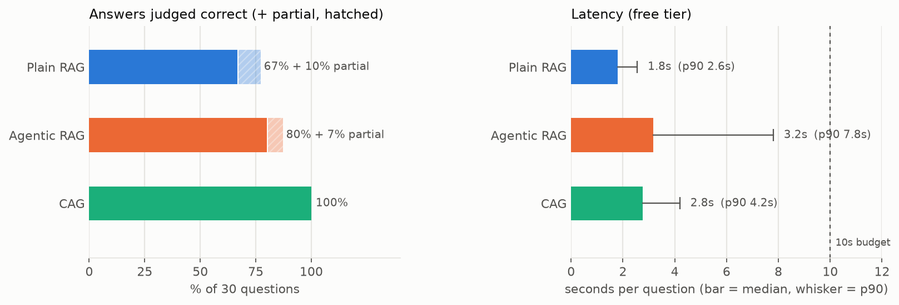
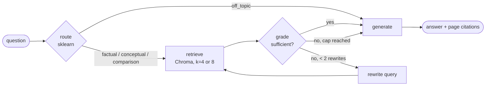

# Agentic RAG: self-correcting retrieval over research papers

A question-answering service over six papers about retrieval-augmented generation. Unlike plain RAG, the agent **grades what it retrieved** and, if the chunks don't actually answer the question, **rewrites the query and searches again** (at most twice). Three strategies are implemented and benchmarked against each other: plain RAG, agentic RAG and CAG (whole paper in the prompt).

**Live demo:** _coming soon_



**When each strategy wins.** On 30 hand-checked questions, CAG answered 30/30, agentic RAG 24/30 and plain RAG 20/30, all within 10 s at p90 (measured on Gemini's free tier). **CAG wins when the knowledge fits in the prompt:** with 1–2 whole papers in context it never missed, but it sends ~25× the input tokens of plain RAG and stops being an option once the corpus is too big for the context window. **Agentic RAG beats plain RAG when the first search lands on the wrong chunks:** the correction loop fixed 5 questions and broke 1 (+13 points, though with 30 questions the 95% interval is 0 to +30), at ~3 LLM calls instead of 1 and +1.4 s median latency. A second retry rarely helped (1 of 4), and both search-based strategies still miss answers spread across tables and two-paper comparisons. Full analysis: [`notebooks/02_benchmark.ipynb`](notebooks/02_benchmark.ipynb).

## How it works



| Step | What it does | Key decision |
|---|---|---|
| **route** | TF-IDF + logistic regression labels the question (~1 ms, no API call) | Adds a *corpus coverage* feature: TF-IDF can't see words it never trained on, so on its own it caught 0/24 off-topic questions; with coverage, 18/24, and 0 answerable questions refused ([`01_router.ipynb`](notebooks/01_router.ipynb)) |
| **retrieve** | Top-k chunks from Chroma (cosine distance), skipping chunks already graded | Without the skip, summary-like chunks (abstracts) win every search and retries see the same 4 chunks |
| **grade** | One structured-output call: is each chunk relevant, and are they together **sufficient**? | Relevance alone isn't enough: on-topic but vague chunks are relevant yet don't answer; sufficiency is what makes the loop fire |
| **rewrite** | New query aimed at what the grader says is missing | Capped at 2: an uncapped loop on an unanswerable question never ends |
| **generate** | Answers only from the chunks, cites `[n]`, says "I don't know" otherwise | Sources list only the chunks actually cited |

## Results

| | Correct (of 30) | Median latency | p90 | LLM calls / question | $ per 1k questions* |
|---|---|---|---|---|---|
| Plain RAG | 20 | 1.8 s | 2.6 s | 1.0 | ~0.5 |
| Agentic RAG | 24 | 3.2 s | 7.8 s | 2.9 | ~2.0 |
| CAG | 30 | 2.8 s | 4.2 s | 2.0 | ~8.3 |

\*At `gemini-3.5-flash-lite` list prices, before CAG's prompt-cache discount; the project itself ran entirely on the free tier. Answers were graded by an LLM judge (`gemini-3.1-flash-lite`, a different model from the one that wrote them) and **every verdict was audited by hand** (88/90 agreement; the 2 corrections are in `data/benchmark/audit_overrides.json`). Latency was measured in the morning (IST); the free tier is much slower at peak hours, when a single call can take 10–40 s.

## Run it locally

Needs Python 3.12 and a free Gemini API key from [Google AI Studio](https://aistudio.google.com/apikey).

```bash
python -m venv .venv
.venv\Scripts\activate          # macOS/Linux: source .venv/bin/activate
pip install -r requirements.txt
cp .env.example .env            # then paste your key into .env

python -m app.corpus            # download the 6 pinned papers from arXiv
python -m app.ingest --from-export   # build the search index from shipped vectors (no API calls)
uvicorn app.main:app            # open http://127.0.0.1:8000
```

Other entry points:

```bash
python -m app.graph "How does CRAG decide a retrieved document is incorrect?"   # watch the loop step by step
python -m app.strategies "your question"     # all three strategies side by side
python -m app.benchmark run && python -m app.benchmark judge                     # re-run the benchmark
pip install -r requirements-dev.txt && python -m pytest                          # tests (some call the API)
```

### API

`POST /ask` with `{"question": "...", "strategy": "agentic_rag" | "plain_rag" | "cag"}` returns `{answer, sources, strategy, route, retries, latency_s}`. `GET /health` reports the index size. The public demo allows 5 questions per minute per visitor and 150 per day overall, to stay inside the free API quota.

## Project layout

```
app/
  main.py          FastAPI: /ask, /health, demo page (static/index.html), rate limits
  graph.py         LangGraph wiring: nodes, edges, the conditional edges
  nodes.py         route, retrieve, grade, rewrite, generate + prompts
  state.py         the State passed between nodes
  router.py        sklearn query router (TF-IDF + corpus coverage)
  ingest.py        PDF -> chunks -> embeddings -> Chroma; index export/import
  cag.py           CAG: pick 1-2 papers, put them in the prompt whole
  strategies.py    the three strategies behind one interface
  benchmark.py     run all questions x strategies; LLM-as-judge
  corpus.py        the 6 papers, pinned by arXiv version + SHA-256
  query_cache.py   question-embedding cache (saves free-tier quota)
notebooks/         01_router (train + evaluate), 02_benchmark (results + charts)
data/              testset.json (30 Q&A), router_queries.csv (150 labels),
                   index/ (shipped vectors), benchmark/ (raw results)
models/router.pkl  trained router
tests/             API, router, grader, CAG, cache, index export
```

## Engineering notes

- **No paper text in the repo.** Three of the papers use arXiv's standard license, which doesn't allow redistribution. `app/corpus.py` downloads pinned versions (checked by SHA-256), and the index ships as **vectors + chunk hashes only**. The deploy re-splits the PDFs, verifies every hash and re-attaches the vectors: an identical index with zero embedding API calls. (A full rebuild costs 635 of the free tier's 1,000 daily embedding requests.)
- **Every network call has a timeout, and the LLM has a fallback.** Found in testing: a Gemini call that never answered left a request hanging for over 5 minutes. At peak hours the free tier slows down per model (`gemini-3.5-flash-lite` took 24–43 s for a trivial call while `gemini-3.1-flash-lite` took 5 s), so each call gives the main model 20 s, then switches to `gemini-3.1-flash-lite` (60 s, one retry). The benchmark measured the main model only. When every model is overloaded, the API returns a clear 503 "try again in a minute".
- **No PyTorch, no local models.** Embeddings and the LLM are API calls, so the server fits Render's free 512 MB (it uses ~300 MB).
- **Stack:** LangGraph, LangChain, ChromaDB, Gemini (`gemini-3.5-flash-lite`, `gemini-embedding-2` at 768 dimensions), scikit-learn, FastAPI, Render.

## Limitations

- 30 test questions with one run each: differences of a few questions are within noise.
- The test questions were written from the papers by the project author and may favour single-paper facts.
- Free-tier quotas and latency: the demo can be slow at peak hours or run out of quota for the day.
- Comparison questions that need one fact from each of two papers are the main failure mode; query decomposition would be the next step.

## Papers

| Paper | arXiv | License |
|---|---|---|
| Lewis et al., *Retrieval-Augmented Generation for Knowledge-Intensive NLP Tasks* | [2005.11401v4](https://arxiv.org/abs/2005.11401v4) | arXiv non-exclusive (not redistributed) |
| Asai et al., *Self-RAG* | [2310.11511v1](https://arxiv.org/abs/2310.11511v1) | CC BY 4.0 |
| Yan et al., *Corrective Retrieval Augmented Generation* | [2401.15884v3](https://arxiv.org/abs/2401.15884v3) | arXiv non-exclusive (not redistributed) |
| Jeong et al., *Adaptive-RAG* | [2403.14403v2](https://arxiv.org/abs/2403.14403v2) | CC0 1.0 |
| Liu et al., *Lost in the Middle* | [2307.03172v3](https://arxiv.org/abs/2307.03172v3) | arXiv non-exclusive (not redistributed) |
| Yao et al., *ReAct* | [2210.03629v3](https://arxiv.org/abs/2210.03629v3) | CC BY 4.0 |
